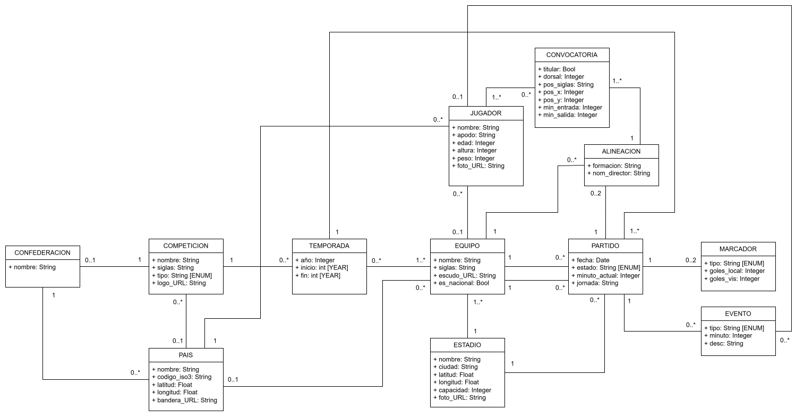

# GeoFootball
## Descripción del proyecto
### *Visualización Interactiva de Partidos de Fútbol en Tiempo Real*

**GeoFootball** es una plataforma web interactiva diseñada para transformar la manera en que los aficionados interactúan con la información futbolística global. A través de un mapa interactivo alimentado por datos geoespaciales y servicios en tiempo real, la aplicación permite explorar el desarrollo de encuentros deportivos, la ubicación física de los estadios, las ligas nacionales e internacionales, y los detalles tácticos de cada partido en un entorno visual fluido.

**ALCANCE DEL PROYECTO**

**Dentro del alcance:**

El sistema utilizara una interfaz de mapa, con limites geográficos de países y ubicación exacta de estadios mediante archivos GeoJSON y coordenadas espaciales, permitiendo filtrar por país, confederación (UEFA, CONMEBOL) o competición activa.

Todos los datos de tiempo real, como partidos, eventos y jugadores serán obtenidos mediante integraciones con APIs externas, las cuales serán gestionadas por el sistema mediante uso de cache para evitar limite de peticiones.

Usando todos los datos recopilados, el sistema generara varias estadísticas sobre países, competencias, jugadores y mas, las cuales podrán ser accedidas mediante sus respectivos perfiles.

**Fuera del alcance:**

Debido a limitaciones con la cantidad de llamadas diarias a la API en el plan gratis el sistema funcionara mas como una prueba de concepto, teniendo un atraso en los resultados en tiempo real y no funcionando correctamente a mayor demanda de usuarios.

Para mantener la escala del proyecto razonable, no se implementara una forma de visualizar las llaves de una competicion tipo copa.

Por ultimo, el sistema no contara con soporte para el registro y/o uso de usuarios, siendo una posible función a añadir en una futura iteración del mismo.

**OBJETIVOS PRINCIPALES**

1. **Ofrecer una experiencia única y completa que permita a sus usuarios tanto encontrar partidos en vivo como descubrir nuevas ligas y equipos.**
2. **Implementar una gestión eficiente de los recursos del sistema y de la API, mediante el uso de cache y otros mecanismos.**
3. **Construir un modelo de backend limpio y modular para facilitar tanto el arreglo de bugs como la implementación de nuevas funcionalidades.**
4. **Garantizar la fiabilidad y respuesta contra errores del sistema, tanto en el backend como en el frontend.**

## Modelo de Dominio

## Bosquejo de Arquitectura [WIP]
**[AGREGAR IMAGEN DE ARQUITECTURA AQUI]**

## Requerimientos
### Funcionales

| ID   | Modulo       | Descripción |
| ---- | -------      | ----------- |
| RF01 | Mapa         | Renderizar mapa interactivo mundial, con contornos geográficos de países y ubicaciones geográficas de estadios
| RF02 | Mapa         | Permitir filtrar los partidos y estadios visibles por país, confederación o competición
| RF03 | Partidos     | Mostrar el listado de todos los partidos recientes (terminados, en juego y próximos), con sus respectivos marcadores, tiempo de juego y equipos 
| RF04 | Partidos     | Exhibir la cronología de eventos clase en un partido, tales como goles, tarjetas rojas/amarillas, sustituciones y mas
| RF05 | Partidos     | Graficar la alineación táctica de ambos equipos, mostrando los jugadores del once titular y sus posiciones junto con todos los suplentes
| RF06 | Estadísticas | Ofrecer una vista detallada de cada equipo y sus datos, incluyendo su estadio sede (con foto), competencias que disputa y partidos recientes
| RF07 | Estadísticas | Mostrar la tabla de posiciones actualizada (puntos, partidos jugados y más) para las competiciones de formato liga, junto con sus partidos recientes
| RF08 | Estadísticas | Mostrar la ficha técnica de un jugador con sus datos personales (edad, dorsal, posición) y estadísticas acumuladas por temporada
| RF09 | Estadísticas | Exhibir una vista básica sobre los paisas y confederaciones, mostrando competiciones pertenecientes a las mismas
| RF10 | Datos        | Consumir información deportiva en tiempo real a través de endpoints de una API externa.
| RF11 | Datos        | Permitir consultar resultados de partidos finalizados y calendarios de encuentros próximos.

### No Funcionales

| ID    | Categoría      | Descripción |
| ----- | -------        | ----------- |
| RNF01 | Portabilidad   | El sistema debe funcionar en múltiples navegadores
| RNF02 | Portabilidad   | El sistema funcionara tanto en pestañas normales como incognito
| RNF03 | Portabilidad   | El sistema se desplegará mediante Docker
| RNF04 | Seguridad      | El token usado pará la API estara almacenada en una variable de entorno
| RNF05 | Mantenibilidad | El sistema estará diseñado con una arquitectura de 3 capas.
| RNF06 | Mantenibilidad | El sistema estará programado en Python 3.8 o superior.
| RNF07 | Mantenibilidad | El sistema utilizara GIT para el control de versión.
| RNF08 | Confiabilidad  | En caso de no poder acceder a datos de la API, el sistema usara el cache (en caso de ser aplicable)
| RNF09 | Confiabilidad  | El frontend utilizara pantallas de errores en casos de fallos para informar al usuario
| RNF10 | Confiabilidad  | En caso de un fallo en una llamada a la API, se intentará dos veces más antes de retornar un error
| RNF11 | Escalabilidad  | El sistema utilizara un sistema de cache para datos con gran volumen de solicitudes para evitar excesivas llamadas a la API
| RNF12 | Rendimiento    | El sistema debe funcionar en un equipo hogareño estándar
| RNF13 | Rendimiento    | El mapa del globo no tardara más de 10 segundos en cargar
| RNF14 | Rendimiento    | Las llamadas a API no deben tardar más de 5 segundos en devolver un resultado
| RNF15 | Reusabilidad   | Toda coordenada geográfica debe ser representada por el mismo objeto
| RNF16 | Reusabilidad   | Todo error común debe ser representado por el mismo objeto
| RNF17 | Flexibilidad   | La gestión de las llamadas a API y sus respuestas deben ser manejadas por una interfaz
| RNF18 | Flexibilidad   | Varios parámetros del sistema, como tiempo de expiración de cache y frecuencia de llamadas a API, deben ser configurables con variables de entorno
| RNF19 | Flexibilidad   | El diseño del backend debe ser modular para permitir la incorporación de nueva funcionalidad sin modificar el resto

## Stack Tecnológico [WIP]

### Capa de datos [WIP]
- **[A DEFINIR]:** Motor de base de datos
- **[A DEFINIR]:** Libreria ORM de Python

### Capa de Negocio

- **Python:** Motor de código  de todo el backend, su uso es obligatorio.
- **Flask (https://flask.palletsprojects.com/):** Framework web, es el más utilizado de Python y uno de los más sencillos.
- **Diskcache:** Librería para gestionar el uso de cache, seleccionada debido a su bajo costo de implementación.
- **API-Football (https://www.api-football.com/):** Fuente de datos y estadísticas de partidos y jugadores, fue elegida debido a la gran cantidad de información que ofrece junto con la generosa cantidad de llamadas en su plan gratis.

### Capa de Presentación [WIP]

- **Vite (https://main.vite.dev/):** Herramienta de desarrollo y empaquetado (Build Tool)
- **React (https://react.dev/):** Libreria de interfaz
- **[A DEFINIR]:** Libreria de componentes de UI